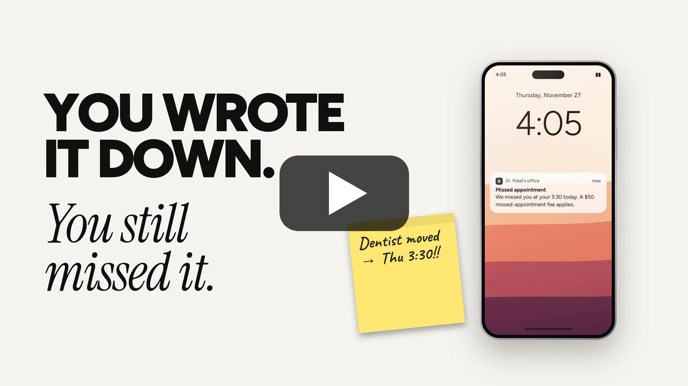
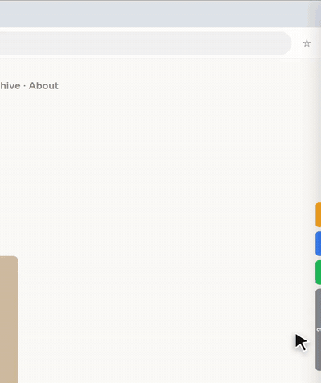
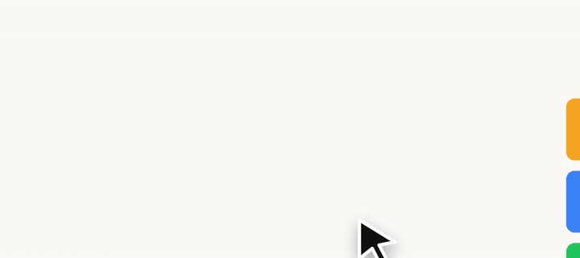
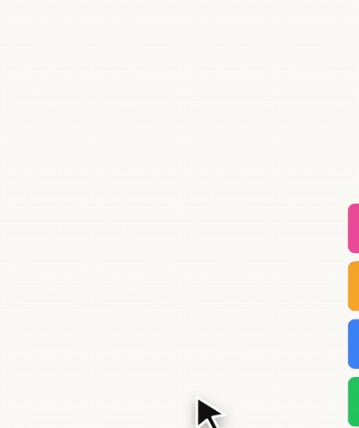

<div align="center">


# Sliptab

**Notes you can't forget, pinned on the edge of your screen.**

Pin a note and it becomes a coloured tab on your screen edge. Hover the tab to read it, over any app.

[Download](https://sliptab.com) · [Watch the demo](https://youtu.be/F-Ru7vPit3U) · [Report a bug](https://github.com/asinadarsh/sliptab/issues/new?template=bug.yml) · [Contribute](CONTRIBUTING.md)


</div>

<p align="center">
  <a href="https://youtu.be/F-Ru7vPit3U"></a>
  <br><sub>35-second demo with voiceover. There is also a <a href="https://youtu.be/KJItT4K_I3c">28-second launch film</a>.</sub>
</p>

## Why

You wrote it down and still forgot, because the note was three windows deep. Sliptab puts notes
where you already look: the edge of your screen.

| Type it once | Hover to read | Waiting when you sit down |
|---|---|---|
|  |  |  |
| Slide to the edge, type, press Enter. Pin it and it gets its own tab. | Hover a tab to read the note over any app, without switching windows. | A note pinned on another device shows up with a glow until you've seen it (Android app coming soon). |

**Also:** checklists you tick off from the edge, links that open in one click, full-text search, a
global shortcut (`Win+Shift+N` / `Super+Shift+N`), and AI agents (Claude Code, Codex, Cursor, Kiro)
that can search and pin notes through MCP at the access level you choose.

## Get Sliptab

- **Windows 10/11** and **Linux x64** (.deb for Ubuntu and Debian, AppImage for other distros):
  [sliptab.com](https://sliptab.com)
- **Microsoft Store:** in review, [apps.microsoft.com/detail/9NS37L3WSB5S](https://apps.microsoft.com/detail/9NS37L3WSB5S)
- **Android:** coming soon. **Mac:** later. Join the waitlist on [sliptab.com](https://sliptab.com).

The Windows installer is not code-signed yet, so Chrome or Windows may warn about it (see
[Code signing policy](#code-signing-policy)). In Chrome choose **Keep**; in Windows click
**More info**, then **Run anyway**.

**Uninstall:** Windows Settings → Apps → Installed apps → Sliptab → Uninstall. On Linux,
`sudo apt remove sliptab` for the .deb, or delete the AppImage.

## This repository and sliptab.com

| | This repository | sliptab.com |
|---|---|---|
| What it is | The source code of the desktop app and its note store (`notes-core`) | Ready-to-install builds, your account, and the hosted sync service |
| Licence | GPL-3.0-only: read it, build it, change it, share it | A service you sign in to |
| You need it if | you want to build Sliptab yourself, fix a bug or add a feature | you just want to use Sliptab |

The sync service and the Android app are separate projects and not part of this repository. The
desktop app works fully without them: notes stay on your computer.

## Free, trial and subscription

- **Free, always:** everything on one computer. Notes, pins, tabs, checklists, links, search,
  shortcut. No account needed, no time limit.
- **30-day free trial, no card:** starts when you sign in with Google. It turns on
  - **sync** between your computers, and with the Android app when it ships;
  - **AI agents** (MCP) reading and writing your notes.
- **Subscription:** keeps sync and AI agents on after the trial. Your notes on each device stay yours
  either way; if you stop, sync stops and nothing is deleted from your computer.

## Build from source

Needs Rust (stable), Node 24 and the Tauri 2 system packages for your OS
([prerequisites](https://v2.tauri.app/start/prerequisites/)).

```bash
cargo test --workspace               # core and app tests
cd desktop
npm ci
npm run check && npm test            # type check and front-end tests
npm run tauri dev                    # run the app with live reload
npm run tauri build                  # installers in target/release/bundle
```

Google sign-in is built in only when `desktop/scripts/google-env.sh` finds an OAuth client file.
Without it the app works fully on your computer; signing in for sync is unavailable in that build.

| Path | What |
|---|---|
| `core/` | `notes-core`: the note model, SQLite + FTS5 store and sync queue |
| `desktop/` | The Tauri app: the edge bar, the panel and the app window (Rust + Svelte) |
| `desktop/PLATFORMS.md` | How the edge bar behaves on each desktop (Wayland, X11, Windows), measured |

## Contributing

Bug reports, fixes and ideas are welcome. Start with [CONTRIBUTING.md](CONTRIBUTING.md): how to
set up, what to test, and how pull requests are reviewed. Good first steps are
[issues](https://github.com/asinadarsh/sliptab/issues) and testing on a desktop we haven't covered
in `desktop/PLATFORMS.md`.

## Code signing policy

Windows releases will be signed: free code signing provided by [SignPath.io](https://about.signpath.io),
certificate by [SignPath Foundation](https://signpath.org) (application in progress; until then the
Windows installer on sliptab.com is unsigned, and the Microsoft Store build is signed by the Store).

- Committers and reviewers: [@asinadarsh](https://github.com/asinadarsh)
- Approvers: [@asinadarsh](https://github.com/asinadarsh)

Only builds made by this repository's GitHub Actions from its own source are submitted for signing,
and each release is approved by hand.

Privacy: notes stay on your device unless you sign in to sync. The app asks sliptab.com for updates
every 6 hours (it sends only the app version and platform); turn this off in Settings → Check for
updates. Link previews are fetched from the linked site itself. Full policy:
[sliptab.com/privacy](https://sliptab.com/privacy).

## Licence

GPL-3.0-only, see [LICENSE](LICENSE). The Sliptab name and logo are not covered by the licence.
